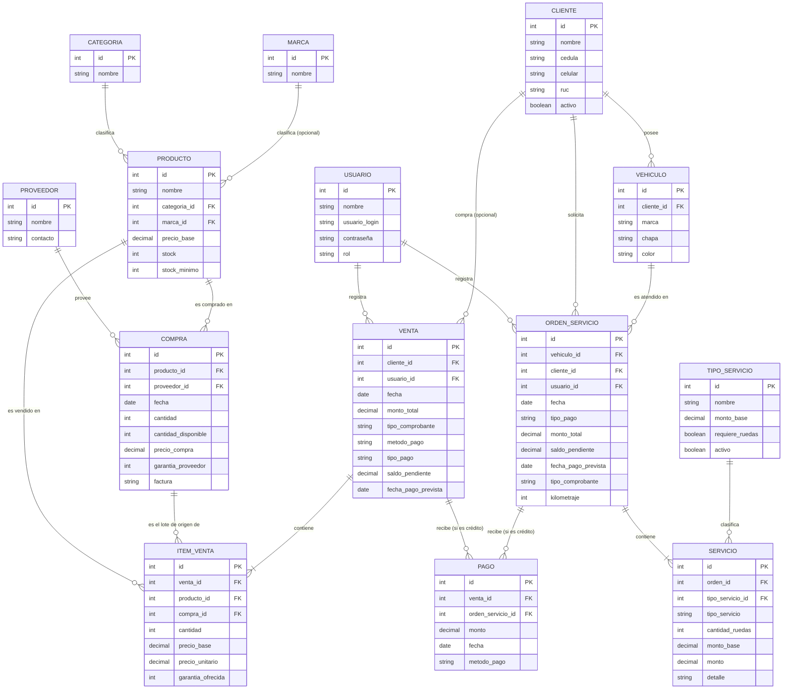

# Diagrama Entidad-Relación (DER)

*Basado en `entidades-dominio.md`. Representa el modelo de datos completo del sistema, incluyendo las correcciones acordadas en las revisiones posteriores (normalización de Orden de Servicio, Categoría como entidad propia, etc.) y las actualizaciones derivadas de la entrevista del 10/09/2026 (eliminación de garantía en servicios, campo `detalle` en Servicio, `fecha_pago_prevista` en Ítem de Venta y Orden de Servicio).*

*Actualizado el 20/11/2026, al cierre del Sprint 2, para reflejar decisiones tomadas durante la implementación que no se habían trasladado acá: entidad `TIPO_SERVICIO` (catálogo, nueva), `método_pago` en `VENTA`, `precio_base` en `ITEM_VENTA`, y la corrección de la nota sobre reparto automático entre lotes (ver "Notas sobre cardinalidades" más abajo) — ver `entidades-dominio.md` para el detalle de cada una.*

*Actualizado nuevamente el mismo día, tras el feedback del dueño al cierre del Sprint 2 (ver `desiciones-alcance.md`, sección 9): se agregó la entidad `MARCA` (relación opcional con `PRODUCTO`). El pedido de kilometraje/próximo mantenimiento no se incluye todavía — ver `entidades-dominio.md`, sección 10.*

*Actualizado el 22/11/2026, durante la planificación técnica del Sprint 3 (punto 1, pantalla de Ventas — ver `sprint-3-backlog.md`): se revirtió el crédito por Ítem de Venta (vigente desde el 23/10/2026) y se lo volvió a nivel de `VENTA` completa, mismo criterio que ya usaba `ORDEN_SERVICIO`. `tipo_pago`, `saldo_pendiente` y `fecha_pago_prevista` se mueven de `ITEM_VENTA` a `VENTA`, y `PAGO` pasa a referenciar `VENTA` (`venta_id`) en vez de `ITEM_VENTA` (`item_venta_id`). Decisión del equipo, todavía no confirmada con el dueño — ver el detalle completo en `entidades-dominio.md`, sección 12.*

*Actualizado el 26/11/2026, al cierre del Sprint 3 (ver `desiciones-alcance.md`, sección 10, y `entidades-dominio.md`, secciones 10 y 14): se agregó el campo `kilometraje` a `ORDEN_SERVICIO`, que ya estaba implementado desde el Sprint 3 pero no se había reflejado en este diagrama; se actualizó la nota sobre `COMPRA–ITEM_VENTA`, ya que el dueño validó un reparto automático editable entre lotes (reemplaza la selección/asignación manual); y se confirmó con el dueño la simetría de crédito entre `VENTA` y `ORDEN_SERVICIO`, que hasta ahora era una decisión del equipo sin validar. El campo para el "próximo mantenimiento" todavía no se incorpora a este diagrama — ver nota en "Notas sobre cardinalidades".*

## Notas sobre cardinalidades

- **CLIENTE–VENTA** es opcional del lado de Cliente (`o{`), ya que una Venta puede ser a un cliente "casual" no registrado, salvo cuando es a crédito (ver HU-10, donde el registro pasa a ser obligatorio a nivel de regla de negocio, no de modelo de datos).
- **VENTA–ITEM_VENTA** y **ORDEN_SERVICIO–SERVICIO** usan `|{` (uno o muchos) del lado del detalle, porque no tiene sentido una Venta sin productos ni una Orden de Servicio sin al menos un Servicio.
- **PRODUCTO–COMPRA** y **PRODUCTO–PROVEEDOR**: la relación muchos-a-muchos entre Producto y Proveedor no aparece como línea directa en el diagrama, porque queda resuelta a través de la entidad intermedia Compra (Proveedor → Compra → Producto).
- **VENTA.fecha_pago_prevista** y **ORDEN_SERVICIO.fecha_pago_prevista** son nullable (solo aplican cuando `tipo_pago = Crédito`) y representan la próxima fecha en la que se espera el pago, no un cronograma de cuotas completo — ver `entidades-dominio.md`, sección 12.1. Es un valor sugerido editable, sin validación bloqueante sobre el plazo. **Corregido 22/11/2026:** antes vivía en `ITEM_VENTA`; se movió a `VENTA` — ver nota de cambio más abajo.
- **SERVICIO.detalle** es nullable/opcional, para precisar la parte afectada cuando aplica (ej. cantidad de ruedas en alineación/balanceo) — ver `entidades-dominio.md`, sección 9.1.
- **VENTA/ORDEN_SERVICIO–PAGO** son relaciones excluyentes: un Pago referencia a uno de los dos, nunca ambos. Esto permite manejar crédito por venta completa y por orden de servicio completa, con pagos parciales acumulables en el tiempo — ver el caso de validación en `entidades-dominio.md`, sección 12.
- **Simetría Venta / Orden de Servicio (corregido 22/11/2026, confirmado por el dueño el 26/11/2026):** `tipo_pago`, `saldo_pendiente` y `fecha_pago_prevista` viven en `VENTA` (crédito por venta completa) y en `ORDEN_SERVICIO` (crédito por visita completa) — ya no hay asimetría entre ambas. Entre el 23/10/2026 y el 22/11/2026 este documento tuvo esos campos en `ITEM_VENTA` en lugar de `VENTA` (crédito por producto individual); se revirtió esa decisión — ver el recorrido completo en `entidades-dominio.md`, sección 12. Era una decisión del equipo sin confirmar con el dueño (implicaba que una Venta ya no admite mezclar productos al contado y a crédito en una misma operación); al cierre del Sprint 3 el dueño validó el nuevo flujo de Ventas sin objetar este punto — ver `desiciones-alcance.md`, sección 10.1.
- **COMPRA–ITEM_VENTA** (`compra_id`, **obligatorio**) traza de qué lote de compra proviene cada unidad vendida. No es opcional: dado que `PRODUCTO.stock` se calcula como la suma de `COMPRA.cantidad_disponible`, toda venta debe descontar de algún lote puntual — ver el problema y la corrección detallados en `entidades-dominio.md`, sección 14. **Resuelto por el dueño el 26/11/2026 (reemplaza la nota anterior del 20/11/2026):** si la cantidad vendida de un producto supera lo disponible en un solo lote, el sistema **reparte automáticamente** la cantidad entre los lotes disponibles (más antiguos primero), generando un Ítem de Venta por cada lote afectado — el Administrador puede editar ese reparto antes de confirmar la venta, pero ya no tiene que armarlo a mano desde cero. No cambia el modelo de datos (sigue siendo un `ITEM_VENTA` por lote, con su propio `compra_id`), solo quién/qué genera esas filas. Ver `entidades-dominio.md`, sección 14, y la pregunta abierta sobre garantía cuando el reparto toca lotes con distinta `garantia_proveedor`.
- **ITEM_VENTA.precio_base** (agregado 24/10/2026, sin reflejarse antes acá): snapshot del `precio_base` del Producto al momento de la venta, para conservar trazabilidad entre precio base y precio final aplicado (HU-18) aunque el producto cambie de precio después — ver `entidades-dominio.md`, sección 7.1.
- **VENTA.metodo_pago** (agregado 24/10/2026, sin reflejarse antes acá): método de pago de la Venta completa (HU-19) — ver `entidades-dominio.md`, sección 7.
- **TIPO_SERVICIO–SERVICIO**: catálogo de tipos de servicio (agregado durante la implementación del Sprint 2, documentado recién el 20/11/2026 — ver `entidades-dominio.md`, sección 9.2). `SERVICIO.tipo_servicio_id` es opcional/nullable (nulo en órdenes anteriores a la incorporación del catálogo); `SERVICIO.tipo_servicio` sigue guardando el nombre como snapshot de texto. `SERVICIO.cantidad_ruedas` y `SERVICIO.monto_base` solo se completan cuando el Tipo de Servicio elegido tiene precio de referencia y/o requiere ruedas.
- **MARCA–PRODUCTO** (agregado 20/11/2026, feedback de cierre del Sprint 2): `PRODUCTO.marca_id` es **opcional** (a diferencia de `categoria_id`, que es obligatorio) hasta confirmar con el dueño si toda marca es obligatoria — ver `entidades-dominio.md`, sección 4.1.
- **COMPRA.garantia_proveedor** se expresa en **meses** (confirmado durante la implementación del Sprint 1; quedaba sin unidad definida en versiones anteriores de este documento y de `entidades-dominio.md`, sección 6).
- **CLIENTE.activo** es la baja lógica del cliente (nunca se borra, se deshabilita) — ver `entidades-dominio.md`, sección 2, y `desiciones-alcance.md`, sección 2.2.
- **ORDEN_SERVICIO.kilometraje** (implementado durante el Sprint 3, agregado recién ahora a este diagrama — faltaba reflejarse acá): kilometraje del vehículo registrado en esa visita, opcional, entero. El campo para el "próximo mantenimiento" **todavía no se agrega a este diagrama**: el modelo implementado durante el Sprint 3 (intervalo fijo por tipo de servicio, cálculo automático) fue descartado por el dueño el 26/11/2026 y se rehace en Sprint 4 — ver `entidades-dominio.md`, sección 10, para el modelo a implementar (carga manual por el Administrador, sin intervalo fijo). Este DER se actualizará cuando ese diseño técnico quede definido.

## Pendiente de confirmar

Este DER da por definidos los puntos abiertos que quedaban en `entidades-dominio.md` (sección 10), salvo el de "Garantía como entidad propia", que se mantiene resuelto acá como campos embebidos por simplicidad del MVP. Si en el futuro la lógica de garantía se complica (estados, vencimientos automáticos, etc.), este diagrama debería revisarse para introducir una entidad `GARANTIA` separada.